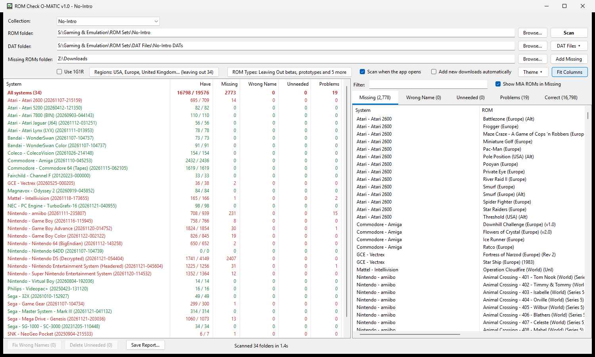
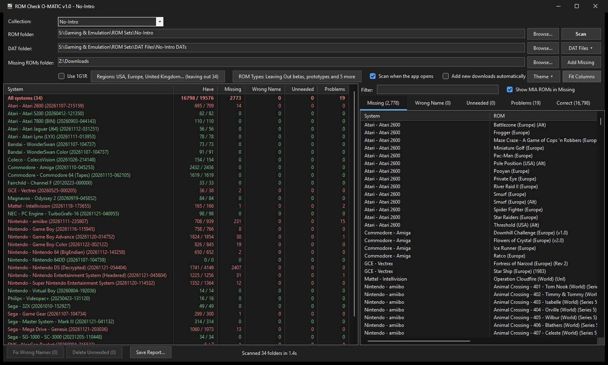

# ROM Check O-MATIC

A portable Windows app that checks No-Intro (cartridge), Redump (disc), MAME (arcade) and TOSEC (computer) ROM sets against their official DAT files. It shows which ROMs are missing, which files have the wrong name, and which files aren't needed, and it can fix the names and remove the unneeded files for you.

> **100% AI-generated.** All of the code in this project was written by Claude (an AI by Anthropic), directed and tested by Michael Winn.





## Why another ROM manager?

I know there are already plenty of ROM managers out there, and some of them are very good. But I found them slow, fiddly, or hard to get to do exactly what I wanted. I made ROM Check O-MATIC to make ROM management easy, fast and as hassle-free as possible: point it at your set, and it tells you straight away what's missing, what's misnamed and what isn't needed, then fixes it for you in a click.

## Features

- **Collections.** Pick **No-Intro**, **Redump** or a collection of your own from the **Collection** box at the top. Each one has its own ROM, DAT, missing ROMs and cue sheets folders, its own 1G1R, Regions and ROM Types settings, and its own hand-picked DATs. The theme, window and column widths are shared.
- **Checks every system at once.** Point it at the folder that holds your set, with one subfolder per system, such as `Sega - Mega Drive - Genesis`. Each subfolder is matched to its DAT by name. Extras after the name, such as `(20240316-023439)`, `(Retool, Europe)` or `(7 MIA)`, are ignored, and Redump-style names such as `Sony PlayStation` or `Sony PSP` are matched too. Folders starting with `!` (such as `!Cuesheets`) are skipped. You can also point it at a single system's folder.
- **Fast.** ROMs are recognised by the size and CRC stored inside each zip or `.7z`, so nothing needs unpacking. About 3,000 Mega Drive zips take under a second, and a whole Redump set takes a few seconds. `.7z` files are read using an installed 7-Zip.
- **Redump discs.** Multi-track discs (cue sheet plus tracks) are recognised by their tracks. When Redump renames a disc its cue sheet changes, so a disc whose tracks all match but whose cue sheet is out of date or missing is counted as one you have. Download Redump's cue sheet packs (the "Cuesheets" zips from redump.org) and choose the folder they're in as the **Cue sheets folder** (this row only appears for disc sets). Loose `.cue` and `.gdi` files work too, and subfolders are searched. If you don't choose one, the app looks in folders starting with `!` inside your ROM folder (such as `!Cuesheets`) and in the DAT folder. The line next to ROM Types says how many cue sheets were found, so you can see at a glance that the folder is right. A disc with an out-of-date cue sheet is then listed under Wrong Name, and fixing it renames its tracks and puts in the exact cue sheet the DAT expects. If the right cue sheet isn't in your packs, it's listed under Problems. GameCube and Wii discs in NKit format (`.nkit.iso`, `.nkit.gcz`) are matched by CRC, which NKit keeps the same as the original disc, and keep their NKit names. Redump's older-style BIOS DATs are read too.
- **MAME.** Make a **MAME** collection with your MAME sets as the ROM folder (one subfolder per set, such as `MAME 0.288 ROMs (non-merged)` and `MAME 0.288 Rollback ROMs`) and your MAME DATs (`.dat` or `.xml`, such as Pleasuredome's) as the DAT folder. Each set folder is matched to its DAT whatever version is in its name, so a 0.288 set is checked against the 0.289 DAT, showing exactly what the update needs: ROMs added or changed (listed under Problems with how many files match), sets MAME has renamed (fixed under Wrong Name), and new sets (Missing). Renaming the folder gives `MAME 0.289 ROMs (non-merged)`. A whole MAME set takes a few seconds. **CHDs** (hard disks, CD-ROMs and laserdiscs) are checked too: get the matching CHD DAT (such as Pleasuredome's `MAME CHDs (merged)`), put it in the DAT folder, and keep your CHDs in a set folder with one folder per game, such as `MAME CHDs (merged)sf2049sf2049.chd`. Each CHD is identified from the SHA1 stored in its header, so even a whole set of large CHDs takes seconds, and both current DATs and older ones (such as MAME 2003 Plus's) are understood. Fixing renames a game's folder and the CHDs in it (a CHD on its own is moved into a folder named after its game), deleting removes a whole game folder, and CHDs are never zipped. Folders with no DAT, such as extras, are listed under Problems and left alone (start their names with `!` to skip them).
- **TOSEC.** Make a **TOSEC** collection with your TOSEC set as the ROM folder and the TOSEC DATs as the DAT folder. TOSEC sets are often kept as packs: one archive per DAT holding every game in a folder of its own, such as `Commodore AmigaGamesGames - [ADF] (TOSEC-v2023-06-14).zip` or `Sinclair ZX81 - Games - [P] (TOSEC-v2025-01-15).zip`. Each pack is checked as a system of its own, matched to its DAT by its name and the folders it's in, so an older pack is checked against the newest DAT. Only the pack's index is read, so even a 17 GB pack takes a second or two. Games TOSEC has renamed are listed under Wrong Name, and ones no longer in the DAT under Unneeded. **Keep TOSEC packs** (shown for TOSEC collections) chooses how they're fixed. Ticked, games are renamed or removed inside the packs: each pack is rewritten once with all its changes, copying the games' data as it is (nothing is recompressed). Unticked, Fix Wrong Names unpacks each pack into a folder beside it named after the DAT (such as `Commodore Amiga - Games - [ADF] (2025-01-30)`), one zip per game with its DAT name, ready for emulators and for Add Missing. Either way, the result is checked by unpacking every file before the old pack is replaced or deleted, and if anything doesn't check out the pack is left as it was. Rewriting or unpacking needs as much free space as the pack takes.
- **Scan when the app opens** (on by default), so the lists are always up to date without clicking Scan.
- **Missing** ROMs, with their CRC32 so they're easy to search for, and MIA ROMs (no known dump) marked and optionally hidden. Right-click to copy names or CRC32s.
- **Add missing ROMs from a folder.** Download missing ROMs into a folder (such as Downloads), choose it as the **Missing ROMs folder** at the top, and click **Add Missing**. The app shows what it found, and when you confirm, each missing ROM is zipped with its DAT name, checked against the DAT, and put in its system folder. Zips, unzipped ROMs, and `.7z`/`.rar` files (using an installed 7-Zip) all work. ROMs made of several files (such as a game on two tapes) can arrive as separate downloads: once all the parts are in the folder they're zipped together, and until then the app tells you how many of the parts are there. Downloads are removed once their ROMs are added, unless they hold other files too. Files you already have, unfinished downloads and anything not in your DATs are left alone.
- **Add new downloads automatically.** Tick **Add new downloads automatically** and the app watches your missing ROMs folder while it's open. Each file is added as soon as it has finished downloading, with a small note in the corner of the screen saying what was added and where. Nothing needs clicking. The app scans your set when it starts, so it knows what's missing.
- **Aftermarket ROMs** in the Missing list are marked. Right-click one to **Find on itch.io**, where most new homebrew is released by its developers, or **Search for the Developer's Page**. The DATs don't record official pages, so these are searches rather than direct links.
- **Wrong name**: right ROM, wrong name. Fixing it renames the zip or `.7z` *and* the files inside it. With 7-Zip installed this is done in place, without recompressing anything, so even big discs are quick; archives 7-Zip won't edit in place are rebuilt instead. Every result is checked against the DAT before it's kept. Stray files in a zip (such as a readme) are left out, and unzipped ROMs are zipped.
- **Unneeded**: files not in the DAT, second copies of a ROM, and (with 1G1R) other versions of a title. Deleting is permanent, so the app always says how many files and how much space first.
- **Ignore list.** Right-click an unneeded file (or one under Problems) and choose **Add to Ignore List (Always Keep)** to keep it for good, such as `Kururin Squash! (Japan) - Translation Guide.txt` next to a Japanese game. It moves to **Correct**, marked "On your ignore list", and is never deleted. Each collection has its own list, stored per system by DAT name, so renaming the folder doesn't lose it. Right-click it under Correct and choose **Remove from Ignore List** to undo.
- **1G1R (one game, one ROM).** Tick **Use 1G1R** to keep one version of each title, using No-Intro's own grouping of versions. Your region order decides (USA, World, Europe... by default, and you can change it). Betas, prototypes, demos, samples and re-releases such as Virtual Console or Evercade only win when there's no full original release. If you have the Europe version but not the USA one, the Europe one is kept until you add the USA one.
- **Leave out regions.** In **Regions...**, untick a region (such as Brazil) to leave out ROMs released only there. They're listed as unneeded and don't count as missing. A ROM also released in a ticked region, such as `(USA, Brazil)`, is kept. The same window sets the region order for 1G1R.
- **Choose which kinds of ROM to keep.** **ROM Types...** lets you keep or leave out betas, prototypes, demos and samples, unlicensed ROMs, pirate ROMs, aftermarket ROMs, BIOS files, applications and test programs, and re-releases (versions taken from Virtual Console, Switch Online, Evercade, Sega Channel, mini consoles, collections, Steam, GOG, budget reissues and similar). ROMs you leave out are listed as unneeded and don't count as missing. **Finished ROMs Only** leaves out everything except finished ROMs.
- **Aftermarket ROMs.** Tick the Aftermarket option on DAT-o-MATIC when downloading, and No-Intro adds a separate DAT for each system, such as `Sega - Mega Drive - Genesis (Aftermarket)`. Put those anywhere in the DAT folder: each system folder is checked against its main DAT and its Aftermarket DAT together. Without an Aftermarket DAT, files with "(Aftermarket)" in the name are kept by name, so they aren't deleted as unneeded. Untick them in **ROM Types...** if you don't want them.
- **Rename system folders with their DAT date**: the system name and the date of the DAT it was checked against, e.g. `Sega - Mega Drive - Genesis (20240316-023439)` becomes `Sega - Mega Drive - Genesis (20261121-203036)`, and `Sony PlayStation` becomes `Sony - PlayStation (2026-06-15 11-55-46)` (not the Redump DAT's own file name, `Sony - PlayStation - Datfile (10914) (...)`). Tags of your own at the end, such as `[NKit]`, are kept. Right-click a system, or right-click **All systems** (or use **DAT Files**) to do them all. Only folder names change.
- **Light and dark themes.** **Theme** can match Windows (and switches when Windows does), or stay light or dark. The app's own pop-ups follow the theme too. The Windows folder and file pickers follow Windows' own setting.
- **Pop-up tips.** Rest the mouse on any button, tick box or field to see what it does. Don't want them? Untick **Theme ▾ › Show Pop-up Tips**.
- **Problems** tab for damaged archives, `.rar` and other unsupported files, zips with only part of a ROM, zips holding several ROMs, discs with an out-of-date cue sheet, and folders with no matching DAT. Right-click a system and choose **Choose DAT...** to match a folder by hand.
- **DAT updates.** **DAT Files ▸ Open the DAT-o-MATIC Download Page** takes you to the Love Pack download. When a new `No-Intro Love Pack*.zip` lands in your Downloads folder, the app offers to unpack it into the DAT folder, and to delete the older pack. When there's more than one copy of a DAT, the newest is always used.
- **Save Report** writes a text report named `!ROM Check report <date>.txt` into the system's own folder, so it sorts to the top. With **All systems** selected, each system gets its own report in its own folder. Scans ignore these reports. Lists can be filtered, sorted by any column, and copied (Ctrl+C).
- **A log** of every rename and delete is kept in `ROM-Check-O-MATIC.log` next to the `.exe`.
- **Fully portable:** a single `.exe`. Settings are saved to `ROM-Check-O-MATIC.ini` next to it.

## Download and run

1. Download the latest zip from the [Releases](../../releases) page and unzip it anywhere.
2. Download the No-Intro Love Pack from DAT-o-MATIC, and unzip it into a folder (or let the app do it, see above).
3. Run `ROM-Check-O-MATIC.exe`, choose your ROM folder and DAT folder, and click **Scan**.

It needs Windows 10 or 11 and uses the .NET Framework 4 that's built into Windows, so there's nothing else to install.

The DAT folder starts out as the folder the `.exe` is in. Subfolders are searched too, so it can be the folder that holds your Love Pack folders.

## Using it

| To... | Do this |
| --- | --- |
| Check everything | Click **Scan** |
| Look at one system | Click it in the list on the left. The buttons at the bottom then act on that system only |
| Fix all the names | **Fix Wrong Names** |
| Remove all unneeded files | **Delete Unneeded** (permanent, after you confirm) |
| Act on just some files | Select them in a list, right-click, and choose **Rename** or **Delete** |
| Find a file | Double-click it to show it in Explorer |
| Match a folder to a DAT by hand | Right-click the system, **Choose DAT...** |

The app only renames, rewrites or deletes files after you confirm. Scanning never changes anything.

### Command line

```
ROM-Check-O-MATIC.exe /report "<ROM folder>" "<report.txt>" [/dat "<DAT folder>"] [/onegame] [/regions "USA, Europe"]
                      [/leaveout "Beta,Proto,Demo,Unlicensed,Pirate,Aftermarket,Bios,Program,Rerelease"] [/fix] [/delete]
                      [/ignoreregions "Brazil, Korea"] [/collection "Redump"] [/addfrom "<missing ROMs folder>"]
```

Writes a report without opening a window. Settings not given use the ones saved by the app. `/fix` renames files to their DAT names, `/delete` permanently deletes unneeded files, and `/addfrom` adds missing ROMs found in a folder (removing those downloads), all without asking. `/addfrom` can be run from Task Scheduler to add downloads automatically.

## Building

```
powershell -ExecutionPolicy Bypass -File build.ps1
```

This uses the C# compiler that comes with Windows, and makes `ROM-Check-O-MATIC.exe` and a release zip in `dist`.

## Licence

MIT. See [LICENSE](LICENSE).
